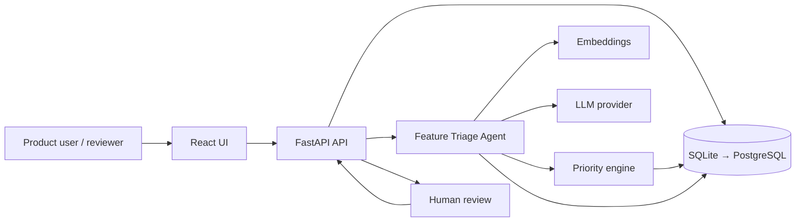

# Architecture (proposed)

This document describes the **planned** high-level architecture for Feature Intelligence during the assessment challenge and a plausible production evolution. Nothing below is implemented yet.

## Goals

- Separate **AI interpretation** from **deterministic business rules** and **human decisions**.
- Support semantic discovery and structured AI artifacts with a **bounded** orchestration model.
- Start simple (SQLite, monolith API) with a documented path to PostgreSQL + pgvector.

## Logical components

### Frontend (React + TypeScript + Vite)

- Presents request submission, discovery/browse, support/interest actions, and read-only views of grouping, scores, and decision briefs.
- Calls the backend REST (or RPC-style) API; does not call LLM providers directly.
- Surfaces human review states and explicit approve/override actions when those specs exist.

### API (FastAPI + Pydantic)

- Validates all inbound payloads; enforces authorization boundaries when auth is added later (out of scope for assessment).
- Orchestrates triage workflows: triggers AI steps, persists results, invokes the deterministic priority engine, and records human decisions.
- Exposes stable contracts defined in future numbered specs.

### Persistence

**Challenge phase:** SQLite for requests, signals (support/interest), embeddings metadata, AI run records, classifications, scores, and review outcomes.

**Production evolution:** PostgreSQL as system of record; **pgvector** for embedding storage and similarity search at scale. Migration strategy (schema versioning, backfill of vectors) to be captured in an ADR when implementation starts.

### AI orchestration

- A **Feature Triage Agent** — bounded workflow, not an autonomous multi-agent system.
- End-to-end product flow (canonical order): raw feature request → AI feature triage → underlying need extraction → theme classification → semantic candidate retrieval → DUPLICATE / RELATED / DISTINCT classification → signal aggregation → deterministic priority score → AI decision brief → human product decision.
- Orchestration steps align with that order across later specs (triage and theme before retrieval/classification; scoring and brief after evidence is assembled).
- Agent may call **tools** (see [AI-DESIGN.md](AI-DESIGN.md)); it does not execute destructive or final product actions.

### Embeddings

- Provider-abstracted embedding generation for request text (and optionally normalized need summaries).
- Stored with request/version references; used for `search_related_requests` and duplicate/related/distinct hints.
- Challenge: SQLite may store vectors as blobs or defer to in-process similarity; production: pgvector indexes.

### LLM

- Provider abstraction (API keys, model selection, timeouts).
- **Structured outputs** (JSON/schema) for needs, themes, relationships, and briefs; validated before persistence.
- Retries with limits; fallback to partial results and manual review states (see [SECURITY-AND-RELIABILITY.md](SECURITY-AND-RELIABILITY.md)).

### Deterministic priority engine

- Pure function(s) over structured fields: signal counts, relationship clusters, theme weights, age, and configured business rules.
- **AI does not override** scores; humans may override **decisions**, not silently rewrite engine rules without spec/ADR.

### Human review

- Queue or inline review for decision briefs and sensitive classifications (e.g. proposed merge as duplicate).
- Records approver identity (when auth exists), timestamp, and optional override rationale for auditability.

## Challenge vs production evolution

| Concern | Assessment (planned) | Production evolution (planned) |
| --- | --- | --- |
| Database | SQLite, single file | PostgreSQL + pgvector |
| Deployment | Local / simple host | Managed DB, backups, HA as needed |
| Search | Embedding similarity at modest scale | Indexed vector search, tuning |
| Secrets | Env vars, no committed secrets | Secret manager integration |
| Observability | Structured logs, correlation IDs | Metrics, tracing, alerting |

No microservices, Kafka, Celery, or Kubernetes are planned for the assessment.

## Context diagram

## Data flow (triage)

1. API persists a new or updated request.
2. AI feature triage extracts underlying need and theme (validated structured outputs).
3. Semantic candidate retrieval and DUPLICATE / RELATED / DISTINCT classification run on related evidence.
4. Signal aggregation feeds the deterministic priority engine.
5. AI decision brief is generated from accumulated evidence; API flags `AI_PARTIAL` or `MANUAL_REVIEW_REQUIRED` when needed.
6. Human product decision (approve / override / defer / reject) is recorded separately from the immutable score recommendation.

Numbered specs define exact entities, endpoints, and state machines.
